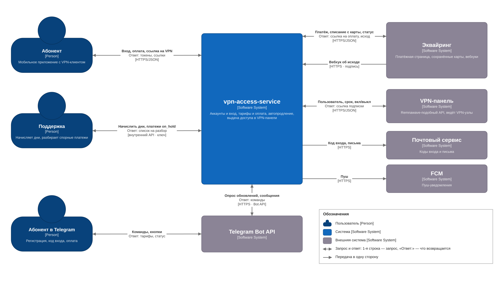
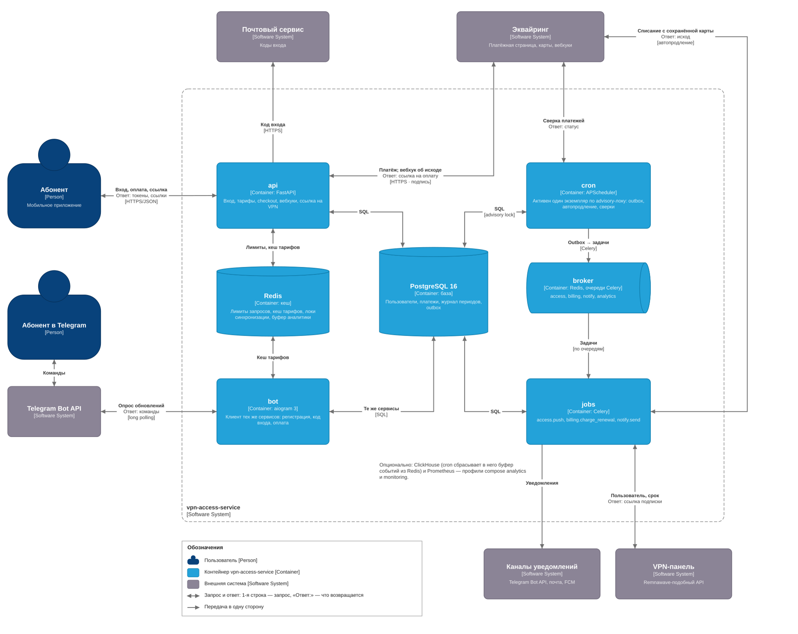
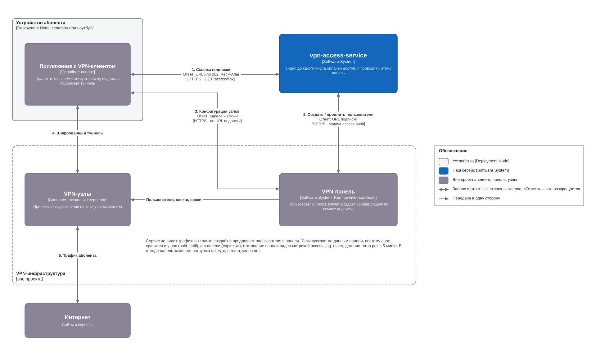
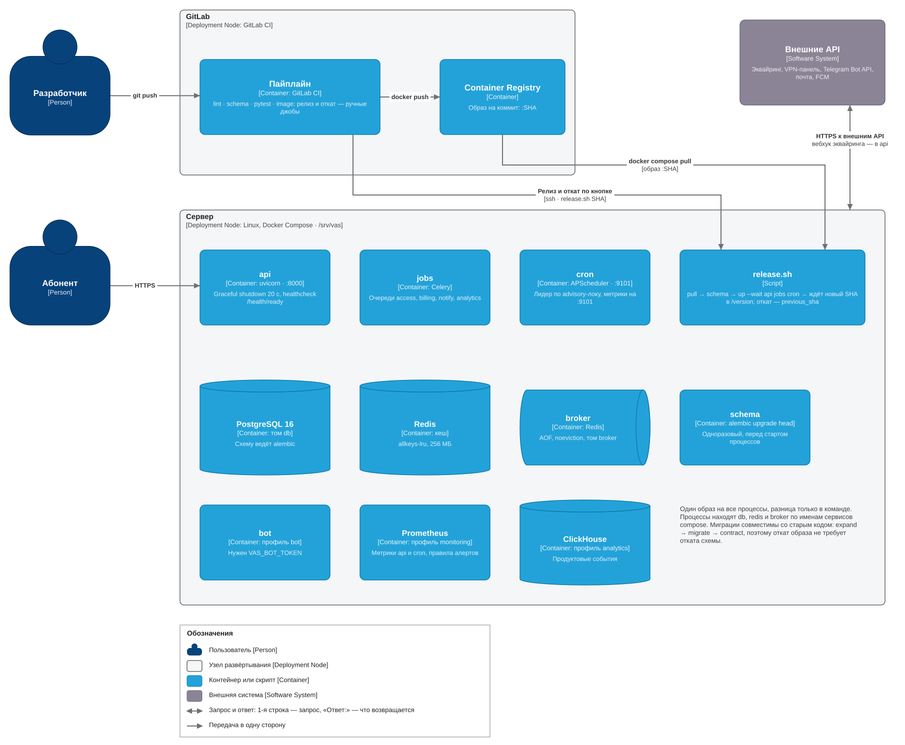

# vpn-access-service

Бэкенд подписочного VPN: вход через Telegram-бота или по коду на почту, оплата тарифа,
автопродление с сохранённой карты, выдача доступа в VPN-панели (API в духе Remnawave).

Сделан как учебный проект, чтобы собрать в одном месте типичные задачи такого сервиса:
идемпотентные платежи, вебхуки, фоновые задачи, сверку с внешними системами, метрики и CI.
Эквайринг и панель — заглушки из `fakes_upstream/`, всё остальное настоящее.

## Стек

Python 3.13, FastAPI, Pydantic v2, SQLAlchemy 2 (async) + asyncpg, Alembic, PostgreSQL 16,
Redis, Celery, APScheduler, aiogram 3, httpx, structlog, Prometheus, ClickHouse,
pytest, Docker Compose, GitLab CI.

## Как запустить

```bash
cp .env.example .env
docker compose up -d --build --wait          # api :8000, fakes :8090
# порт 5432 занят локальным Postgres? VAS_DB_PORT=5433 docker compose up -d --build --wait
uv run python scripts/e2e.py                 # сквозной сценарий против стенда
docker compose --profile monitoring up -d    # Prometheus :9090
```

Документация API: http://localhost:8000/docs

Тесты (нужны Postgres и Redis, например `make dev`):

```bash
uv sync
uv run pytest --cov
```

## Устройство

Модульный монолит: код разложен по фичам, у каждой свои модели, логика и HTTP-ручки.

```
src/vas/
  core/       БД, Redis, вызовы внешних API, ошибки, метрики, логи, токены
  accounts/   пользователи, вход (бот, почта), устройства, refresh-токены
  billing/    тарифы, платежи, журнал периодов, автопродление, сверка
  access/     синхронизация с VPN-панелью, ссылка на подписку
  notify/     Telegram, почта, push (FCM)
  events/     outbox, аналитика в ClickHouse
  jobs/       Celery: задачи
  cron/       APScheduler: периодические задачи, один активный экземпляр
  bot/        Telegram-бот
  web.py      FastAPI-приложение
  runtime.py  сборка зависимостей процесса
```

Процессы: `api`, `jobs` (Celery), `cron`, `bot`, `schema` (миграции). Образ один на всех.

Подробнее о решениях — в [docs/architecture.md](docs/architecture.md).

## Схемы

### C4 · уровень 1: контекст

[](docs/architecture/diagrams/c4/c4-context.drawio.svg)

### C4 · уровень 2: контейнеры

[](docs/architecture/diagrams/c4/c4-containers.drawio.svg)

### Как абонент получает VPN

Сервис не стоит на пути трафика: он отдаёт приложению ссылку подписки и держит пользователя в панели
в актуальном состоянии. Конфигурацию узлов клиент берёт у панели, трафик идёт напрямую через узлы.

[](docs/architecture/diagrams/c4/vpn-access.drawio.svg)

### C4 · развёртывание

[](docs/architecture/diagrams/c4/c4-deployment.drawio.svg)

Состояния платежа — в [docs/architecture.md](docs/architecture.md#состояния-платежа). Схемы открываются
в полном размере по щелчку. Файлы `.drawio.svg` можно править в draw.io, но источник истины — описания в
[`tools/docs-diagrams/c4.py`](tools/docs-diagrams/c4.py):
`make diagrams` перегенерирует SVG и проверяет, что подписи не закрывают чужие линии (нужен только Python).

## Главные решения коротко

- **Подписка — журнал периодов.** Оплата, триал, бонус за друга и ручное начисление
  добавляют строку в `access_periods` с уникальным источником. Повторный вебхук не может
  добавить второй период: упрётся в `UNIQUE (source_type, source_id)`.
- **Статус платежа меняется условным UPDATE.** `... SET status='paid' WHERE status IN
  ('new','awaiting') RETURNING id`: кто первым поменял, тот и применяет оплату.
- **Автопродление выводится из состояния.** Cron раз в час ищет подписки, которые кончаются
  в ближайшие 24 часа, и создаёт попытку с ключом `(user_id, cycle_end, attempt)`.
  Если человек продлил сам, `paid_until` сдвинулся, и старая попытка пропускается.
- **Панель догоняет нашу БД.** Задача читает желаемый срок заново при каждом запуске,
  uuid пользователя в панели генерируем сами, поэтому повторы безопасны.
- **Outbox.** События пишутся в той же транзакции, что и данные; cron отдаёт их в Celery.
- **Устройства — слоты.** Пять на аккаунт, лок на строке пользователя против гонки,
  при входе с шестого можно освободить слот.

## Что упрощено

- Эквайринг и панель — заглушки. Реальный эквайринг отличается форматом, но не логикой.
- Токен FCM берётся из настроек; в проде его выдаёт google-auth по сервисному аккаунту.
- Деплой — `docker compose` на одном сервере; без Kubernetes и без blue-green.
