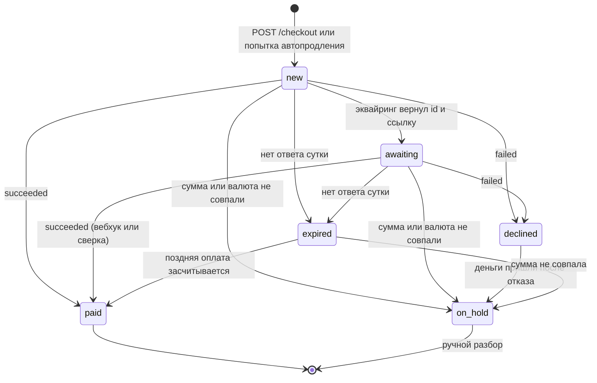

# Архитектура

## Оплата

```
клиент ──POST /checkout (Idempotency-Key)──► api
  api: INSERT payments (new) ON CONFLICT (user_id, client_key) DO NOTHING
  api ──create_charge, ключ = id платежа──► эквайринг
  api: UPDATE ... SET status='awaiting' WHERE status='new'
клиент платит на странице эквайринга
эквайринг ──POST /hooks/acquirer (подпись, может прийти дважды)──► api
  одна транзакция:
    INSERT provider_events ON CONFLICT DO NOTHING      ← повтор события
    UPDATE payments SET status='paid' WHERE status IN ('new','awaiting') RETURNING
    SELECT subscriptions ... FOR UPDATE                ← параллельные оплаты по очереди
    INSERT access_periods ON CONFLICT DO NOTHING        ← повтор применения
    UPDATE subscriptions SET paid_until = конец нового периода
    INSERT outbox (access.push, notify, analytics)
```

Если вебхук не пришёл, раз в 5 минут сверка спрашивает эквайринг про платежи, которые
висят в `new`/`awaiting` дольше 10 минут. Платёж, брошенный на сутки, становится `expired`,
но поздняя оплата по нему всё равно засчитывается. Сумма не совпала или деньги пришли
после отказа — платёж уходит в `on_hold` для ручного разбора (`GET /internal/payments/on-hold`).

## Состояния платежа

Каждый переход — условный `UPDATE ... WHERE status IN (...) RETURNING`: из двух параллельных
обработчиков переход выполнит только первый.



## Автопродление

```
cron, раз в час:
  INSERT renewal_attempts (user_id, cycle_end = paid_until, attempt = 1)
    SELECT ... WHERE autorenew AND карта есть AND paid_until в ближайшие 24 ч
    ON CONFLICT DO NOTHING
  UPDATE renewal_attempts SET state='sent' WHERE state='planned' AND run_after <= now
  INSERT outbox (renewal.charge)
celery billing.charge_renewal(attempt_id):
  лок попытки и подписки
  есть уже платёж этой попытки? → повторяем тот же запрос (ключ тот же)
  иначе проверяем: paid_until всё ещё = cycle_end? автопродление включено? пользователь активен?
  списание с карты → тот же путь применения, что у вебхука
```

Отказ банка: повтор через 24 часа, потом через 72, после третьего отказа автопродление
выключается и пользователь получает уведомление. Таймаут при списании не повторяем
вслепую: попытка остаётся `unknown`, исход находит сверка.

## Доступ в VPN

`panel_accounts.panel_uuid` генерируется у нас до первого запроса в панель. Задача
`access.push` берёт короткий лок в Redis на пользователя, читает `paid_until` и приводит
панель к нему: создать, обновить или ничего не делать. Ответ на создание потерялся —
следующая попытка найдёт пользователя по тому же uuid. Раз в 5 минут cron ставит задачу
всем, у кого `synced_until` не равен `paid_until` дольше 5 минут. Метрика `access_lag_users`.

Пока аккаунта в панели нет, `GET /access/link` отвечает 202 и `Retry-After`.

## Вход

- Бот: `/start` создаёт пользователя и триал, `/login` выдаёт код вида `K7QP-M3XA`
  (8 символов, живёт 5 минут), приложение меняет его на токены.
- Почта: шестизначный код, храним HMAC от него; 1 код в минуту, 5 в час, 5 неверных попыток.
- Access-токен JWT на 15 минут; refresh одноразовый, меняется при каждом обновлении.
  Повторное использование старого refresh отзывает всю цепочку этого входа.
- Каждый запрос проверяет, что устройство ещё существует: удалили устройство — доступ
  пропадает сразу, а не через 15 минут.

## Фоновые процессы

| Процесс | Что делает |
|---|---|
| jobs (Celery) | `access.push`, `billing.charge_renewal`, `notify.send`, `analytics.track` |
| cron (APScheduler) | outbox → Celery (2 с), автопродление (1 ч), сверка платежей и панели (5 мин), сброс аналитики (15 с), уборка (6 ч) |

Celery: `acks_late`, `reject_on_worker_lost`, prefetch 1. В каждом процессе воркера свой
event loop и свой пул соединений. Cron может работать в нескольких экземплярах, активен
тот, кто держит advisory-лок в Postgres.

## Метрики и алерты

`api_requests_total{route,method,code}`, `api_latency_seconds`,
`upstream_requests_total{upstream,op,result}`, `payments_applied_total{origin}`,
`renewal_attempts_total{result}`, `access_lag_users`, `outbox_backlog`,
`cron_last_ok_timestamp{job}`. Правила — в `deploy/prometheus/rules.yml`.

## Релиз

GitLab CI: линтер и mypy, проверка миграций (одна голова, `alembic check`, вниз и вверх),
тесты на настоящих Postgres и Redis, сборка образа. Релиз по кнопке: `deploy/release.sh`
прогоняет миграции, перезапускает процессы и ждёт, пока `/version` отдаст новый SHA.
Откат — отдельная кнопка на предыдущий образ. Миграции пишутся так, чтобы старый код
с новой схемой работал: сначала добавить, потом переключить код, потом убрать старое.
